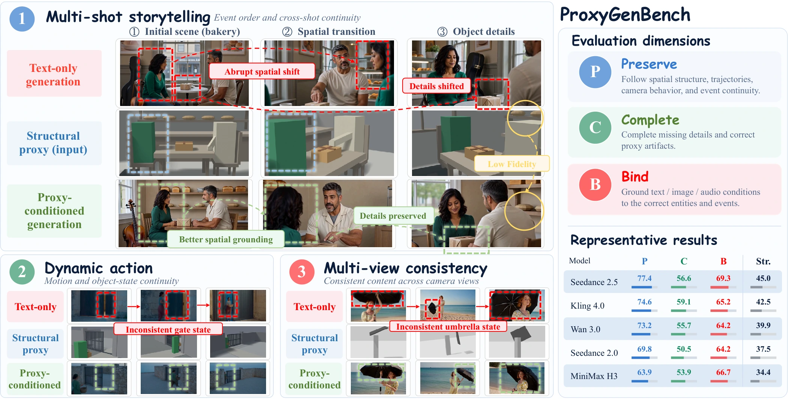

<div align="center">

# ProxyGenBench

### Benchmarking Proxy-Guided Video Generation

[](https://2kxx.github.io/ProxyGenBench/)
[](https://2kxx.github.io/ProxyGenBench/assets/ProxyGenBench.pdf)
[](https://2kxx.github.io/ProxyGenBench/#results)

</div>

## ⚡ TL;DR

**ProxyGenBench tests whether video generators can turn rough scene plans into
finished videos that follow the intended action, fill in missing details, and
use text, image, and audio references correctly.** Across five generators,
proxies improve spatiotemporal control, but stronger structural guidance does
not automatically yield better completion or correct condition binding.

## 🎬 Overview



**A convincing frame is not always a coherent video.** In the bakery example
above, text-only generation changes the spatial arrangement and object details
across shots. A rough animated scene helps the generator keep the conversation
in the same space, with more consistent object details. The gate and multi-view
examples show why motion, object states, and continuity also need explicit guidance.

These **structural proxies** are simple video plans that specify scene layout,
movement, camera behavior, and event order. But a proxy is **a plan, not the
finished video**: its blocky geometry, placeholder materials, and rigid motion
should not simply be copied. Text, image, and audio conditions tell the generator
how to realize the scene and which details belong to which characters or events.

**ProxyGenBench evaluates this balance through three complementary capabilities:**
**Preserve** the intended structure, motion, and timing; **Complete** missing
content and correct proxy artifacts; and **Bind** multimodal conditions to the
right entities and events. Together, they measure more than visual quality or
similarity to the proxy: they assess whether the finished video follows the
intended scene while completing what the rough plan leaves unfinished.

## ✨ Highlights

- 🎥 **60 scenes, 312 evaluation cases** spanning dynamic action, multi-shot storytelling,
  and multi-view consistency, with controlled variations in proxy fidelity,
  text detail, and image/audio references.
- 📋 **32 fine-grained criteria** instantiated as verified, case-specific
  checklists; a structure-aware **Strict** score penalizes critical failures.
- 📊 **Five video generators evaluated:** proxies improve spatiotemporal control,
  while completion and multimodal binding remain challenging.

## 🏆 Leaderboard

Paper-reported results, ranked by **Strict** within each reference-input group.
All scores are on a **0–100** scale; higher is better.

### Without Audio References

| Rank | Model | Preserve | Complete | Bind | Average | **Strict** | Joint |
| :---: | :--- | ---: | ---: | ---: | ---: | ---: | ---: |
| 🥇 | **Seedance-2.5** | 77.4 | 56.6 | 69.3 | 67.8 | **45.0** | 14.0 |
| 🥈 | Kling-4.0 | 74.6 | 59.1 | 65.2 | 66.3 | **42.5** | 15.0 |
| 🥉 | Wan-3.0 | 73.2 | 55.7 | 64.2 | 64.4 | **39.9** | 16.4 |
| 4 | Seedance-2.0 | 69.8 | 50.5 | 64.2 | 61.5 | **37.5** | 17.4 |
| 5 | MiniMax-H3 | 63.9 | 53.9 | 66.7 | 61.5 | **34.4** | 7.2 |

### With Audio References

| Rank | Model | Preserve | Complete | Bind | Average | **Strict** | Joint |
| :---: | :--- | ---: | ---: | ---: | ---: | ---: | ---: |
| 🥇 | **Seedance-2.5** | 64.5 | 61.2 | 74.0 | 66.6 | **32.5** | 4.0 |
| 🥈 | Wan-3.0 | 61.7 | 51.1 | 62.4 | 58.4 | **32.4** | 8.0 |
| 🥉 | Seedance-2.0 | 63.3 | 55.0 | 71.8 | 63.4 | **31.4** | 8.0 |
| 4 | MiniMax-H3 | 55.3 | 53.6 | 65.4 | 58.1 | **24.1** | 2.0 |

**Strict** penalizes critical structural failures; **Joint** is the percentage
of cases passing all critical Preserve checks. Audio references are independent
input conditions, not audio generated in the output video.

## 🚀 Release

- ❌ **Evaluation code:** Will be released after review.
- ❌ **Dataset:** Will be released after review.

## 📚 Citation

```bibtex
@misc{tang2026proxygenbench,
  title={ProxyGenBench: Benchmarking Proxy-Guided Video Generation},
  author={Tang, Zhenchen and Lu, Haolin and Yang, Songlin and
          Zhao, Xiaotong and Zhang, Ran and Peng, Bo and Li, Shuai and
          Fan, Haotian and Zhong, Haobin and Zhang, Yanni and
          Li, Songlian and Zhang, Ning and Gao, Xun and Zhao, Alan and
          Dong, Jing},
  year={2026},
  note={Preprint},
  url={https://2kxx.github.io/ProxyGenBench/}
}
```
